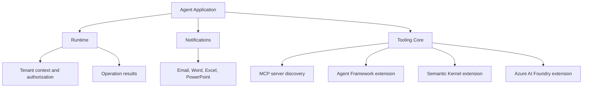
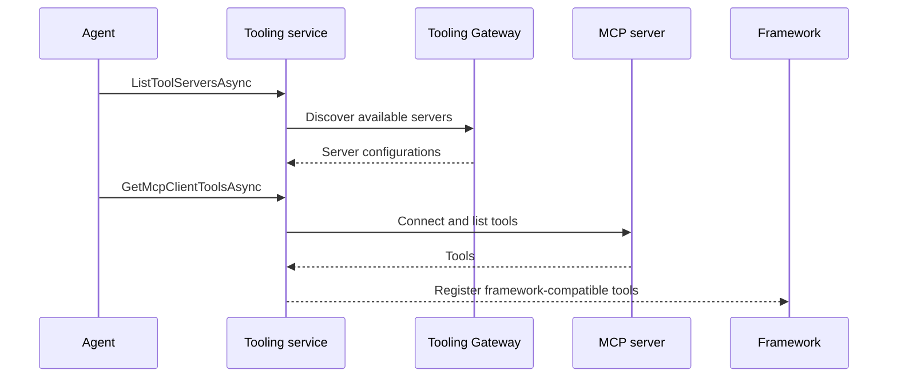

# Microsoft Agent 365 SDK for .NET - Design Documentation

## Overview

The SDK extends the Microsoft 365 Agents SDK with three maintained modules:

- **Notifications**: Event-driven notification handling for Microsoft 365 applications.
- **Runtime**: Core utilities for multi-tenant agent applications.
- **Tooling**: MCP (Model Context Protocol) server discovery and framework-specific tool registration.

All remaining packages target `net8.0`. Observability has moved to the [Microsoft OpenTelemetry .NET distro](https://github.com/microsoft/opentelemetry-distro-dotnet/tree/main); see the [migration guide](observability-migration.md). This repository no longer builds or publishes Observability packages.

## Repository structure

```text
src/
  Runtime/Core/
  Notification/Microsoft.Agents.A365.Notifications/
  Tooling/
    Core/
    Extensions/
      AgentFramework/
      SemanticKernel/
      AzureAIFoundry/
  Tests/
```

## Packages

| Package | Purpose | Detailed design |
|---|---|---|
| `Microsoft.Agents.A365.Runtime` | Tenant context, operation results, authorization | [Runtime](../src/Runtime/Core/docs/design.md) |
| `Microsoft.Agents.A365.Notifications` | Microsoft 365 notification handling | [Notifications](../src/Notification/Microsoft.Agents.A365.Notifications/docs/design.md) |
| `Microsoft.Agents.A365.Tooling` | MCP server discovery and configuration | [Tooling Core](../src/Tooling/Core/docs/design.md) |
| `Microsoft.Agents.A365.Tooling.Extensions.AgentFramework` | Agent Framework MCP tool registration | [Agent Framework](../src/Tooling/Extensions/AgentFramework/docs/design.md) |
| `Microsoft.Agents.A365.Tooling.Extensions.SemanticKernel` | Semantic Kernel MCP tool registration | [Semantic Kernel](../src/Tooling/Extensions/SemanticKernel/docs/design.md) |
| `Microsoft.Agents.A365.Tooling.Extensions.AzureAIFoundry` | Azure AI Foundry MCP tool registration | [Azure AI Foundry](../src/Tooling/Extensions/AzureAIFoundry/docs/design.md) |

## Architecture

Framework-agnostic services live in core packages. Tooling extensions adapt those services to individual AI frameworks without adding framework-specific behavior to the core.



### Runtime

`TenantContextHelper` extracts tenant and worker IDs from HTTP context claims, headers, and items. `AgenticAuthorizationService` handles authorization for agentic operations. `OperationResult` and `OperationError` provide consistent success/failure results with error details and HTTP status codes.

```csharp
return OperationResult.Success;
return OperationResult.Failed(new OperationError("Not found", HttpStatusCode.NotFound));
```

### Notifications

`AgentNotification` routes notification events; `AgentNotificationActivity` wraps the activity and associated data. Models such as `EmailReference`, `EmailResponse`, and `WpxComment` provide typed access to notification contents.

Supported sub-channels include `agents:email`, `agents:word`, `agents:excel`, and `agents:powerpoint`. Lifecycle events include user identity creation and automatic sign-in; Federated Knowledge Service notifications are also supported.

Applications register handlers through extension methods such as `OnAgenticEmailNotification()` and `OnAgenticUserIdentityCreatedNotification()`.

### Tooling

`IMcpToolServerConfigurationService` abstracts discovery and configuration. `McpToolServerConfigurationService` implements it, using `MCPServerConfig` to describe server endpoints and authentication details. Framework-specific extensions register discovered MCP tools with their orchestrator.



Tooling also supports sending chat history for threat protection. HTTP authentication and tenant/context headers remain part of the Tooling integration; applications can supply context from their chosen instrumentation without referencing the retired SDK packages.

## Build and testing

`src/dirs.proj` traverses Notifications, Runtime, and Tooling. Test projects live under `src/Tests/`; the solution explicitly includes six source and seven test projects. Keep solution entries synchronized when adding, renaming, or deleting projects even where traversal uses automatic discovery.

From the repository root:

```powershell
dotnet build src\Microsoft.Agents.A365.Sdk.sln
dotnet test src\Microsoft.Agents.A365.Sdk.sln
dotnet format src\Microsoft.Agents.A365.Sdk.sln --verify-no-changes
```

NuGet versions are centralized in `src/Directory.Packages.props`; package versions derive from git history through Nerdbank.GitVersioning. Common build properties enable nullable analysis, XML documentation, and warnings as errors.

See [build documentation](../build/BUILD.md), [package setup](../src/PACKAGE-SETUP.md), and the generated [dependency diagram](../DEPENDENCIES.md). Historical changelog entries describe earlier releases, not the current package set.
